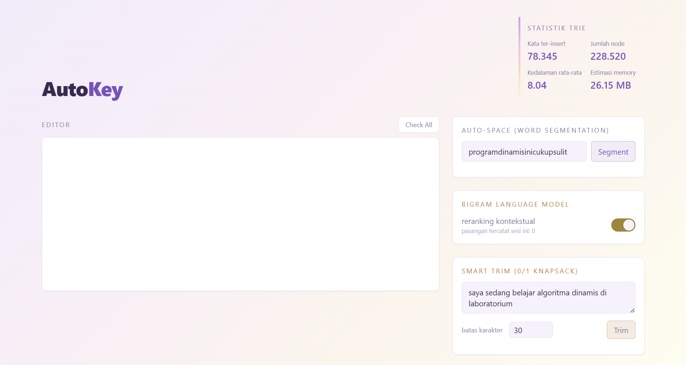
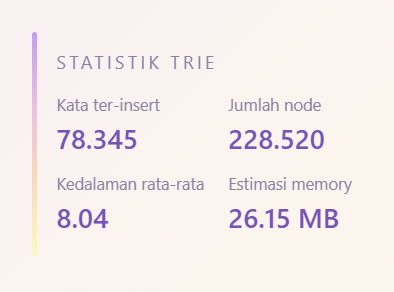
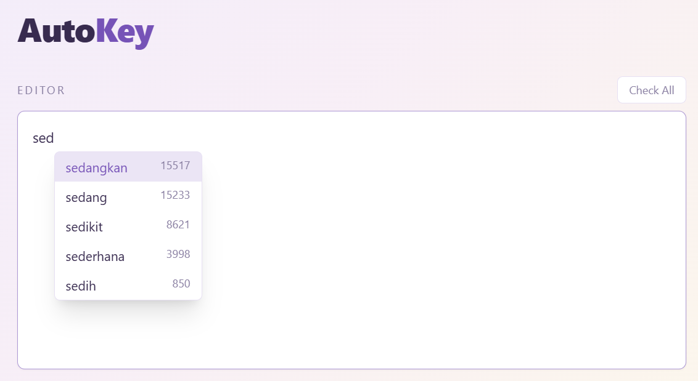
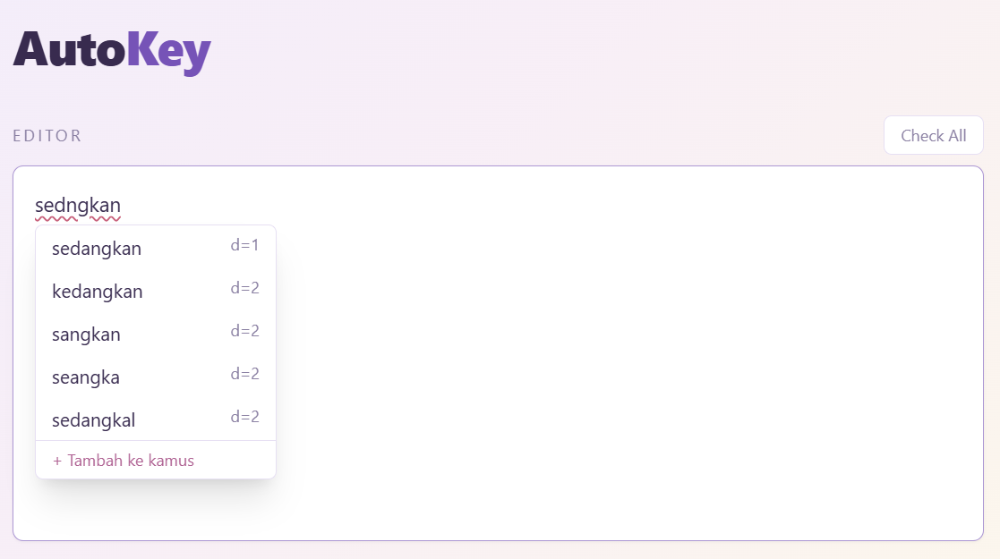
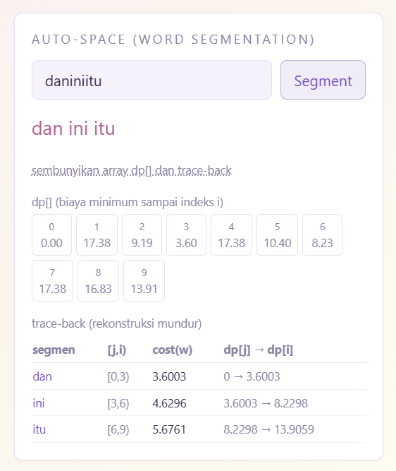

# AutoKey

Teks editor web Bahasa Indonesia dengan autocomplete, spell checker, dan
Auto-Space (word segmentation).

## Deskripsi Program

AutoKey adalah editor teks berbasis web yang membantu pengguna menulis dalam
Bahasa Indonesia dengan tiga kemampuan utama:

1. **Autocomplete**: saran kata muncul tiap keystroke berdasarkan prefix yang
   diketik, memakai struktur **Trie**.
2. **Spell check**: kata yang tidak dikenali digarisbawahi merah, dengan
   saran koreksi dihitung memakai **Levenshtein Edit Distance** (Dynamic
   Programming).
3. **Auto-Space (Word Segmentation)**: teks tanpa spasi otomatis dipecah
   menjadi kata-kata valid memakai **Dynamic Programming** bergaya
   Viterbi atau IDF-cost.
4. **Smart Trim** (0/1 Knapsack): untuk memendekkan teks secara optimal.
5. **Bigram Language Model**: untuk autocomplete yang sadar konteks kalimat.

## Fitur Program

- [x] Trie from scratch (insert, search, starts_with, get_suggestions)
- [x] Statistik Trie real time di UI (jumlah kata, jumlah node, kedalaman
      rata-rata, estimasi memory)
- [x] Autocomplete top 5 dengan Tab/Enter untuk complete
- [x] Levenshtein Edit Distance DP (tabel n×m eksplisit)
- [x] Spell check di editor (underline merah, klik untuk saran, "Tambah ke
      kamus", tombol "Check All")
- [x] Word Segmentation / Auto-Space dengan tampilan array `dp[]` dan
      traceback
- [x] Smart Trim (0/1 Knapsack) dengan rekonstruksi kata yang dipertahankan
- [x] Bigram Language Model dengan toggle ON/OFF dan counter pasangan kata

## Tech Stack

| Layer    | Teknologi                                   |
| -------- | -------------------------------------------- |
| Backend  | Python 3.11+, FastAPI, Uvicorn                |
| Frontend | Next.js 14 (App Router), TypeScript, Tailwind |
| Data     | `data/kamus.json` (diload backend saat start)|

Backend menggunakan Python karena mudah untuk mengekspresikan DP dan Trie secara
eksplisit serta ekosistem FastAPI yang ringan untuk REST API lokal.

## Struktur Proyek

```
AutoKey/
├── backend/
│   ├── app/
│   │   ├── main.py
│   │   ├── trie.py
│   │   ├── levenshtein.py
│   │   ├── segmentation.py
│   │   ├── knapsack.py
│   │   └── bigram.py
│   ├── data/
│   │   └── kamus.json
│   └── requirements.txt
├── docs/
│   └── screenshots/
│       ├── 01-tampilan-awal.png
│       ├── 02-statistik-trie.png
│       ├── 03-autocomplete.png
│       ├── 04-spell-check.png
│       └── 05-auto-space-dp.png
└── frontend/
    ├── app/
    │   ├── page.tsx
    │   ├── layout.tsx
    │   └── globals.css
    ├── components/
    │   ├── Editor.tsx
    │   ├── StatsPanel.tsx
    │   ├── SegmentationPanel.tsx
    │   ├── SmartTrimPanel.tsx
    │   └── BigramPanel.tsx
    └── lib/
        ├── api.ts
        └── caret.ts
```

## Cara Menjalankan Program

### 1. Jalankan backend

```bash
cd backend
python3 -m venv venv
source venv/bin/activate
pip install -r requirements.txt
uvicorn app.main:app --reload --port 8000
```

Backend akan otomatis load `data/kamus.json` dan membangun Trie saat
startup. Cek `http://localhost:8000/api/stats` untuk memastikan berjalan.

### 2. Jalankan frontend

```bash
cd frontend
npm install
npm run dev
```

Buka `http://localhost:3000`. Secara default, frontend memanggil backend di
`http://localhost:8000` (bisa diubah lewat env `NEXT_PUBLIC_API_URL`).

## Penjelasan Trie

Trie (prefix tree) diimplementasikan from scratch di `backend/app/trie.py`
memakai `dict` Python per node (`TrieNode.children: dict[str, TrieNode]`). Tiap node menyimpan:

- `children`: pemetaan huruf ke node anak
- `is_end` : apakah node ini akhir sebuah kata valid
- `freq` : frekuensi kata (hanya berarti jika `is_end = True`)

Operasi:

- **Insert** `O(L)` : telusuri/bangun path sepanjang kata, tandai node
  terakhir sebagai `is_end`.
- **Search** `O(L)` : telusuri path kata, valid jika path lengkap ada dan
  node terakhir `is_end`.
- **Starts with** `O(L)` : sama seperti search tapi tidak perlu `is_end`.
- **Get suggestions(prefix, topN)** : telusuri ke node prefix, lalu DFS ke
  seluruh subtree untuk mengumpulkan kata valid, diurutkan berdasarkan frekuensi
  (descending), ambil topN.

Statistik (jumlah kata, jumlah node, kedalaman rata-rata, estimasi
memory) dihitung dari struktur Trie itu sendiri, kedalaman rata-rata
dihitung dari kedalaman tiap node `is_end`, dan estimasi memory = jumlah
node × estimasi ukuran byte per node.

## Penjelasan Levenshtein Edit Distance

Diimplementasikan di `backend/app/levenshtein.py` sebagai tabel DP penuh
berukuran `(n+1) × (m+1)`:

**Basis**
```
dp[i][0] = i   untuk semua i   (hapus i huruf dari s)
dp[0][j] = j   untuk semua j   (sisipkan j huruf ke s)
```

**Relasi Rekurens**
```
cost = 0 jika s[i-1] == t[j-1], else 1
dp[i][j] = min(
    dp[i-1][j]   + 1,
    dp[i][j-1]   + 1,
    dp[i-1][j-1] + cost
)
```

`dp[n][m]` adalah jarak edit minimal. Untuk spell check, kata input
dibandingkan terhadap **seluruh kata di kamus** (via `trie.all_words()`),
kata dengan distance ≤ 2 dikumpulkan lalu diurutkan **distance ASC, lalu
frekuensi DESC**. Filter panjang kata (`|len(s)-len(t)| > 2` langsung
dilewati) dipakai murni sebagai optimasi jumlah pasangan yang dihitung,
bukan pengganti algoritma DP. Pasangan yang lolos filter tetap
dihitung dengan tabel DP lengkap.

## Penjelasan Word Segmentation

Diimplementasikan di `backend/app/segmentation.py`. Untuk string tanpa
spasi `s` sepanjang `n`:

**Basis**
```
dp[0] = 0
```

**Relasi Rekurens**
```
dp[i] = min atas semua j < i di mana s[j:i] valid:
            dp[j] + cost(s[j:i])
```

**Cost**
```
cost(w) = log(N / freq(w))
N = total kemunculan seluruh kata di kamus (Σ freq)
freq(w) = frekuensi w di kamus, atau 1 jika w tidak ada di kamus
```

Hal ini pada dasarnya adalah *negative log-likelihood* unigram (`-log P(w)`),
sehingga segmentasi optimal = urutan kata dengan total "kejutan" (surprisal)
minimum. Array `dp[]` penuh beserta pointer `choice[i]` (indeks j terbaik)
disimpan untuk traceback mundur dari `i = n` sampai `i = 0`, dan keduanya
ditampilkan apa adanya di UI.

## Smart Trim (0/1 Knapsack)

Terletak di `backend/app/knapsack.py`. Tiap kata di teks = 1 item dengan
`weight = panjang karakter`, `value = log(N/freq(kata))`. Tabel DP 2D penuh
`dp[i][w]` dibangun sesuai basis/rekurens, lalu
di traceback untuk menentukan kata mana saja yang dipertahankan, sambil mempertahankan urutan asli kata dalam teks.

## Bigram Language Model

Terletak di `backend/app/bigram.py`. Selama sesi editor berjalan, tiap kali dua kata
berurutan **sama-sama valid** di kamus, pasangan `(kata_sebelumnya,
kata_sekarang)` dicatat. Saat autocomplete dipanggil dengan kata sebelumnya
diketahui, kandidat dari Trie di-*rerank* berdasarkan
`P(kandidat | prev) * freq(kandidat)`. Jika kata sebelumnya tidak punya data
bigram sama sekali, atau tidak ada kandidat yang match, hasil fallback-nya ke
urutan unigram asli. Toggle ON/OFF dan counter pasangan tersedia di UI.

## Screenshot Hasil Program

### Tampilan awal



### Statistik Trie



### Autocomplete



### Spell check dengan garis merah dan dropdown saran



### Panel Auto-Space dengan array dp[]



## Tautan Video Demo

https://drive.google.com/file/d/1Eq_cGTpMkiH2a6I3ZBxxnPrACp8LM1SM/view?usp=sharing

## Referensi

- KBBI V Dataset: aryakdaniswara/kbbi-dataset-kbbi-v
- Frequency Distribution Bahasa Indonesia: ardwort/freq-dist-id
- GeeksforGeeks: Trie (Insert and Search)
- GeeksforGeeks: Edit Distance
- GeeksforGeeks: 0/1 Knapsack Problem
- GeeksforGeeks: Word Break Problem
- Manning, Raghavan & Schütze: Introduction to Information Retrieval (Inverse Document Frequency)
- Jurafsky & Martin: Speech and Language Processing (SLP3), Bab 3 — N-gram Language Models